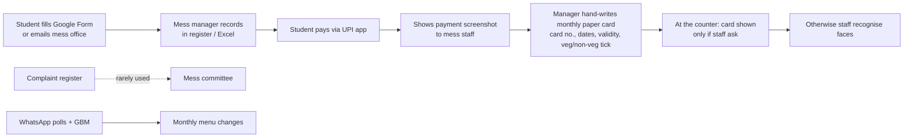

# 01 · Discovery — Current ("as-is") system

Source: the team's own experience as mess users at South Asian University. **Validate every point below** with the interviews and survey in this folder before treating it as fact in the SRS; record what changes in `findings.md`.

## Current process

## Pain points and the fraud vectors they open

| # | Pain point | Who suffers | Fraud / failure vector |
|---|---|---|---|
| P1 | Card checked only sometimes | Mess (revenue) | Unsubscribed students eat; cards lent to friends |
| P2 | Handwritten cards | Mess | Validity dates edited; photocopies |
| P3 | Payment shown as a screenshot | Mess | Old, edited or someone else's screenshot |
| P4 | No record of who ate which meal | Mess, kitchen | Same student eats twice; no data for planning |
| P5 | Missed meal = lost money | Students | Students pay for ~20–30 % meals they never eat (to be measured in survey) |
| P6 | Kitchen cooks for "everyone" | Kitchen, environment | Food waste |
| P7 | Late arrivals may get nothing | Students | — |
| P8 | Registration/cancellation by Forms + email | Manager, students | Lost requests, slow refunds, disputes |
| P9 | Separate veg/non-veg prices tracked manually | Manager | Students on veg plans taking non-veg |
| P10 | Day-scholar and per-meal payments ad hoc | Day scholars, manager | Untracked cash/UPI per meal |
| P11 | Complaint register rarely used | Students, committee | Complaints are shouted, not resolved |
| P12 | Menu decided in WhatsApp polls / GBM | Committee | Duplicate votes, no record, non-members vote |

## What must be preserved

- The mess office's Excel habit → MealSync exports CSV.
- Committee authority over the menu → only committee members edit the menu.
- Separate veg / non-veg pricing, day-scholar options, pay-per-meal option.
- A human at the counter has the final say → the scanner gives a clear SERVE / DO NOT SERVE but staff still hand over the plate.
