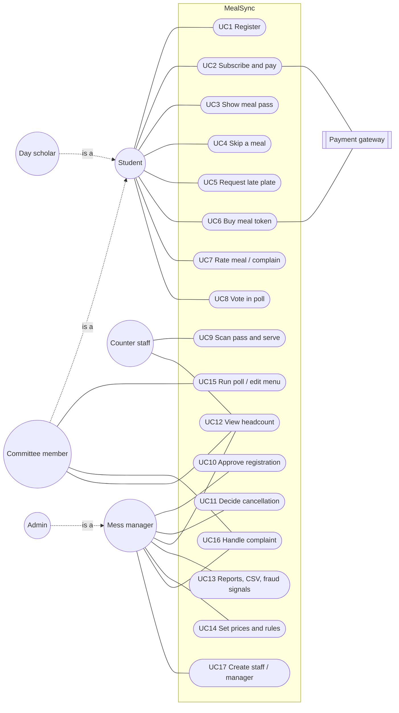
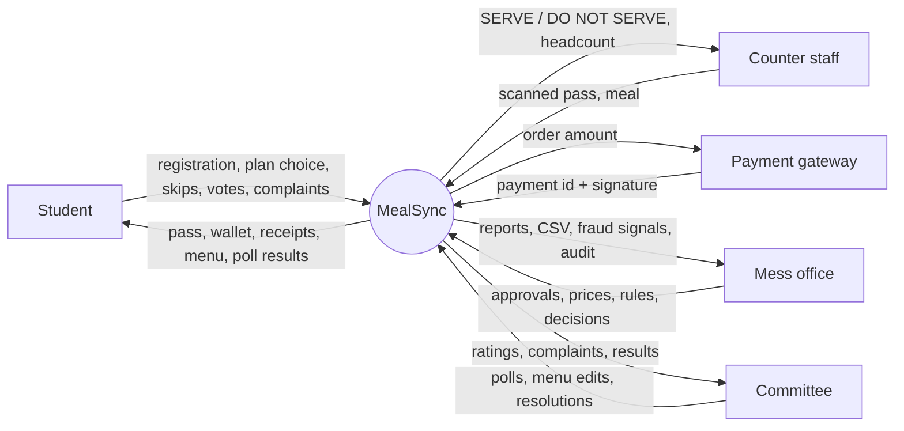
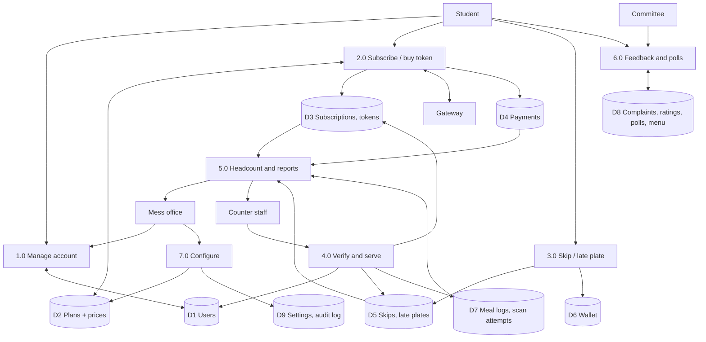
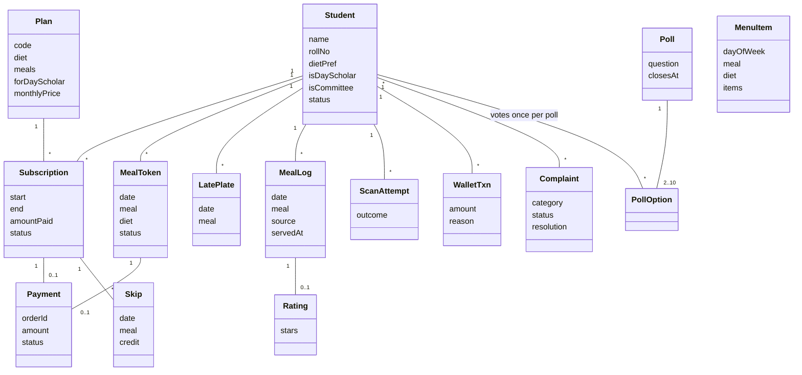

# 03 · Analysis — Use cases, data flow, domain model

Owner: Ananya (System Analyst). Inputs: [SRS](02-srs.md). The ER diagram and data dictionary are in [database.md](database.md).

## 1. Actors and use cases

## 2. Key use-case specifications

### UC2 — Subscribe and pay
| | |
|---|---|
| Actor | Student (approved) · Payment gateway |
| Pre-condition | Logged in, status approved, no overlapping subscription |
| Trigger | Student chooses a plan and a month |
| Main flow | 1. System lists plans for the student's residence type. 2. Student picks plan + month. 3. System computes the pro-rated amount, creates the subscription (pending payment) and a payment order. 4. Gateway collects money and returns paymentId + signature. 5. System verifies the signature, marks the payment paid and the subscription active (one transaction). |
| Alternatives | 3a. Overlap → 409. 3b. Plan for the other residence type → 400. 5a. Signature invalid → payment failed, subscription stays pending; student may retry or discard. 5b. Verify repeated → same success, no duplicate effect. |
| Post-condition | Active subscription covering start..end of month |
| Requirements | FR-10 … FR-15 |

### UC9 — Scan pass and serve
| | |
|---|---|
| Actor | Counter staff |
| Pre-condition | Staff logged in on the scanner, meal selected |
| Main flow | 1. Student opens pass. 2. Staff scans QR (or types code). 3. System checks signature → freshness → account → skip → entitlement → serving window → not already served. 4. System records the meal and shows SERVE with name, roll no., diet and source. |
| Alternatives | 3a–3g. Any check fails → attempt logged with the reason, DO NOT SERVE shown with the reason (for repeat: first-serve time). |
| Post-condition | `meal_logs` row (served) or `scan_attempts` row (refused) |
| Requirements | FR-20 … FR-27 |

### UC4 — Skip a meal
| | |
|---|---|
| Actor | Student (approved, subscribed) |
| Main flow | 1. Student picks a meal in the next 7 days. 2. System checks a covering subscription, the cut-off and the monthly limit. 3. System stores the skip and credits the wallet (one transaction). 4. The headcount for that meal drops by one. |
| Alternatives | 2a. After cut-off → 400 with the cut-off time. 2b. Limit reached → 400. 2c. Already skipped → 409. |
| Requirements | FR-30 … FR-32, FR-37 |

### UC11 — Decide cancellation
| | |
|---|---|
| Actor | Mess manager |
| Main flow | 1. Student requested cancellation. 2. Manager opens requests and approves. 3. System computes the refund for unused days, shortens the subscription to today, credits the wallet, writes the audit log. |
| Alternatives | 2a. Manager rejects → subscription active again. 2b. Request already decided → 409. |
| Requirements | FR-16, FR-17, FR-53 |

### UC16 — Handle complaint
| | |
|---|---|
| Actors | Mess manager, committee member |
| Main flow | 1. Student files a complaint (open). 2. Manager marks in progress or escalates to the committee. 3. The handler resolves it with a note, which the student sees. |
| Rules | State machine in [04-design §5](04-design.md#5-state-machines). Committee acts only on escalated tickets. |
| Requirements | FR-40, FR-41 |

## 3. Data flow diagrams

### Level 0 (context)

### Level 1

## 4. Domain model (conceptual)

