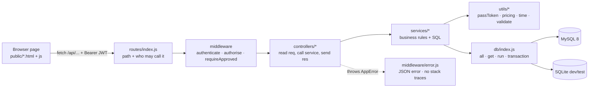
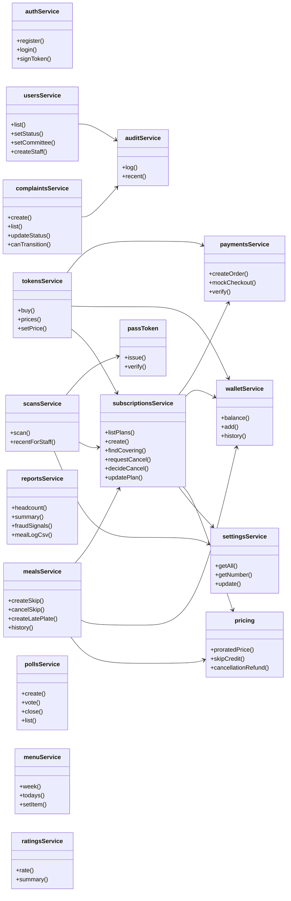
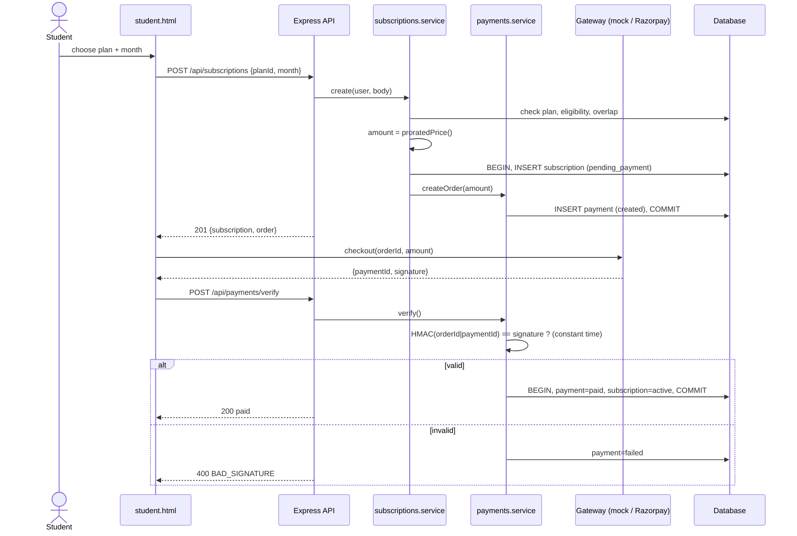
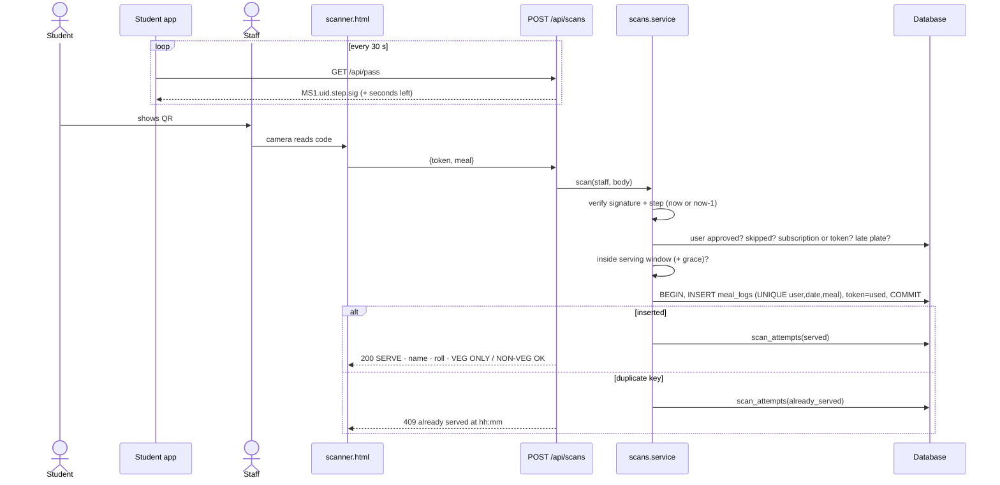
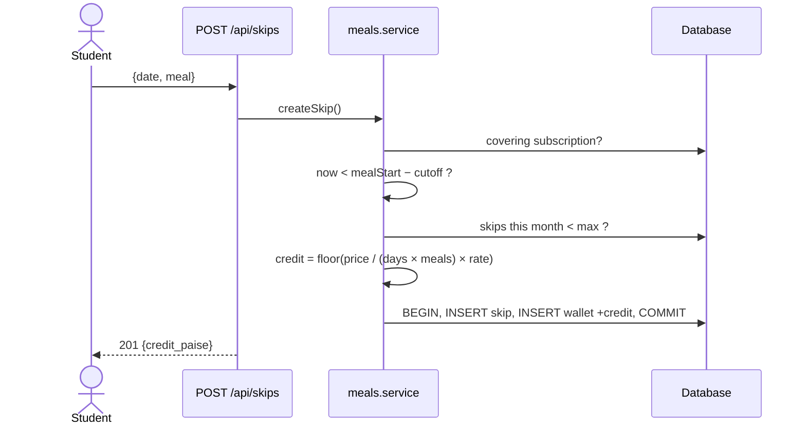
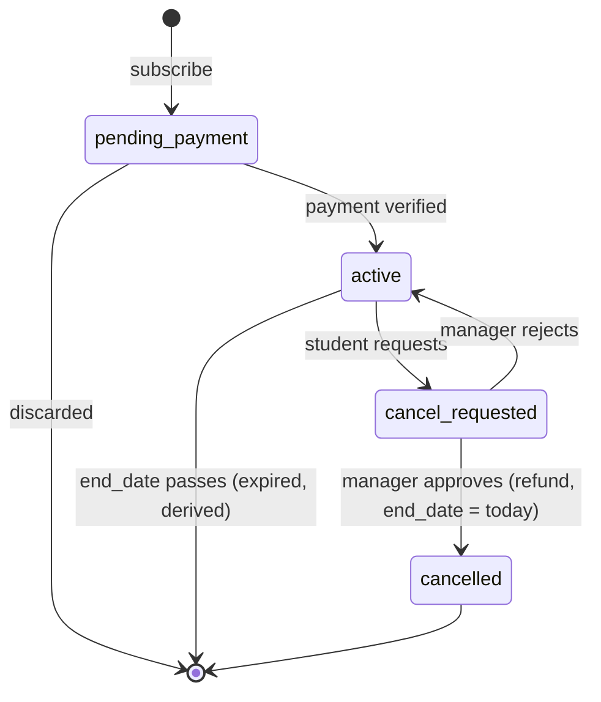
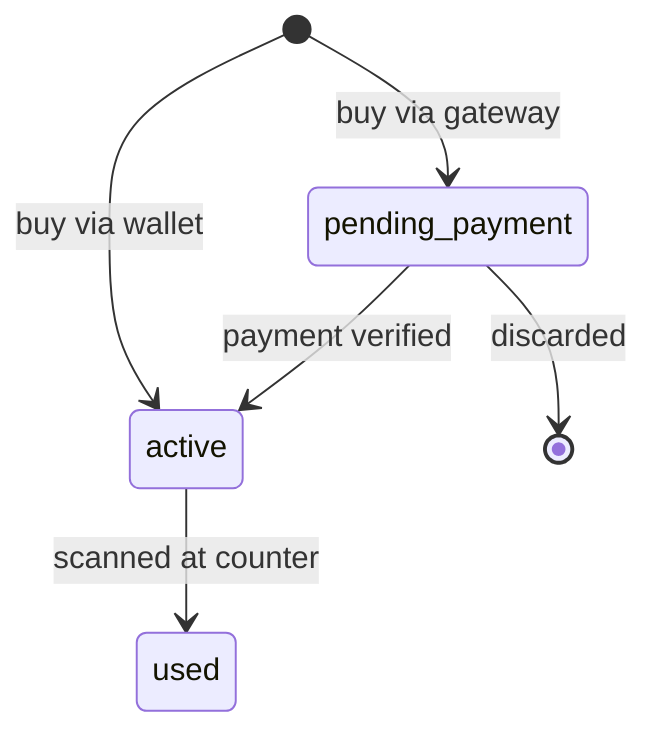
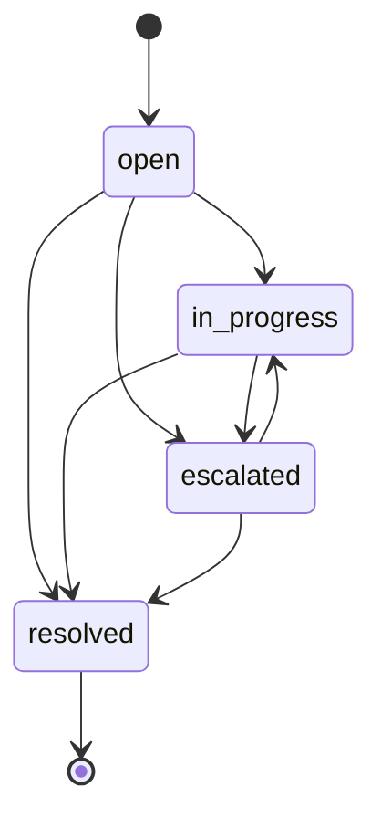
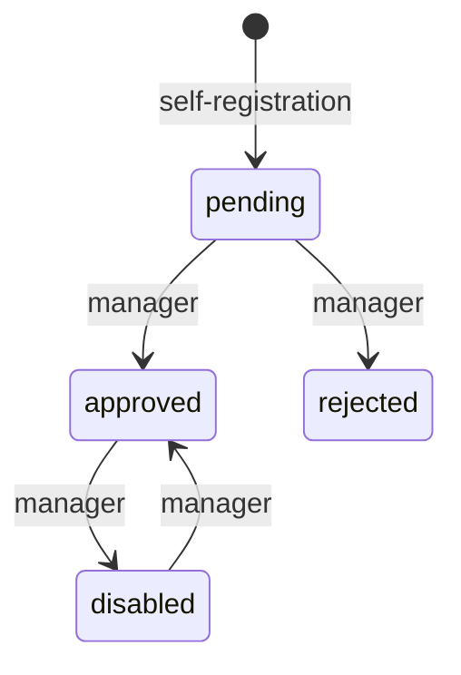

# 04 · Design

Owners: Arkodyuti (software design), Sania (UI/UX). Inputs: [SRS](02-srs.md), [analysis](03-analysis.md). Architecture-level decisions are in [05](05-architecture.md) and [ADRs](adr/).

## 1. Layered design

Every request travels the same path, which keeps each file small and easy to defend:

| Layer | Rule |
|---|---|
| Routes | Only wiring: URL, HTTP verb, middleware, controller. Reading this one file tells you the whole API and its permissions. |
| Controllers | No business logic. Translate HTTP ↔ function call and choose the status code (201, 204…). |
| Services | All business rules and SQL. Services never touch `req`/`res`, so they can be tested and reused. Services call each other (e.g. `scans` → `subscriptions.findCovering`). |
| Utils | Pure functions (no DB): easy to unit test. Money and time maths lives here. |
| DB adapter | Hides MySQL vs SQLite. Same `?` placeholders; normalises duplicate-key errors to `err.isDuplicate`. |

We merged the "model" layer into services on purpose ([ADR-0003](adr/0003-layered-monolith.md)).

## 2. Module view

## 3. Sequence diagrams

### 3.1 Subscribe and pay (FR-11 … FR-14)

### 3.2 Scan at the counter (FR-20 … FR-25)

### 3.3 Skip a meal (FR-30)

## 4. Pass token design (anti-fraud core)

`MS1.<userId>.<step>.<sig>` where `step = floor(unixSeconds / 30)` and `sig = base64url(HMAC-SHA256(PASS_SECRET, "userId.step"))[0..22]`.

| Attack | Why it fails |
|---|---|
| Show a friend's screenshot later | Older than the previous step → `expired_token` |
| Edit the user id in the code | Signature no longer matches → `invalid_token` |
| Forge a pass | Needs `PASS_SECRET`, which never leaves the server |
| Two friends use one pass at once | Second scan hits UNIQUE(user, date, meal) → `already_served` and is logged |
| Brute-force the signature | 22 base64url chars ≈ 131 bits; constant-time comparison |
| Student on a veg plan takes non-veg | Scanner shows **VEG ONLY** in large text on every serve |

The pass is generated by the server (not the phone) so the secret is never shipped to clients. Trade-off: the phone needs connectivity to refresh; the manual code covers camera issues (offline passes are backlog item B-07).

## 5. State machines

### Subscription

### Meal token

### Complaint

Implemented as the `TRANSITIONS` table in `complaints.service.js` and tested in `tests/unit/rules.test.js`.

### Student account

## 6. API summary

Full contract: [openapi.yaml](openapi.yaml) (Swagger UI at `/api-docs`). Errors are always `{ "error": { "code": "...", "message": "..." } }`.

| Area | Endpoints | Who |
|---|---|---|
| Auth | `POST /auth/register`, `POST /auth/login`, `GET /auth/me` | public / any |
| Plans & prices | `GET /plans`, `GET /meal-prices` | any |
| Subscriptions | `POST /subscriptions`, `GET /subscriptions/mine`, `DELETE /subscriptions/:id`, `POST /subscriptions/:id/cancel` | student |
| Payments | `POST /payments/mock-checkout/:orderId` (dev), `POST /payments/verify`, `GET /payments/mine` | student |
| Pass | `GET /pass` | approved student |
| Meals | `POST /skips`, `GET /skips/mine`, `DELETE /skips/:id`, `POST /late-plates`, `GET /late-plates/mine`, `GET /meals/history` | student |
| Tokens & wallet | `POST /tokens`, `GET /tokens/mine`, `DELETE /tokens/:id`, `GET /wallet` | student |
| Counter | `POST /scans`, `GET /scans/recent` | staff, manager, admin |
| Feedback | `POST /complaints`, `GET /complaints/mine`, `GET /complaints`, `PATCH /complaints/:id`, `POST /ratings`, `GET /ratings/summary` | student / committee + office |
| Menu & polls | `GET /menu`, `GET /menu/today`, `PUT /menu`, `GET /polls`, `GET /polls/:id`, `POST /polls`, `POST /polls/:id/vote`, `POST /polls/:id/close` | any / committee |
| Office | `/admin/users…`, `/admin/cancel-requests`, `/admin/subscriptions/:id/cancel-decision`, `/admin/plans…`, `/admin/meal-prices`, `/admin/settings`, `/admin/headcount`, `/admin/reports/{summary,fraud,meals.csv}`, `/admin/audit` | manager, admin (headcount also staff + committee) |

Status codes used: 200, 201 (created), 204 (deleted, no body), 400 (validation / business rule), 401 (not logged in), 402 (insufficient wallet balance), 403 (role / approval / entitlement), 404, 409 (duplicate / wrong state), 429 (rate limit), 500.

## 7. UI / UX design

Owner: Sania. Principles: **one primary action per screen**, mobile first (students use phones), no colour-only meaning, large touch targets.

| Page | Layout | Key decisions |
|---|---|---|
| Login / register | Two tabs, single column | Register explains that approval is needed, so "pending" is not a surprise |
| Student | Tabs: Pass · Subscription · Skip/late · Tokens · Wallet · Feedback · Menu & polls | Pass tab first (most frequent action). QR on white with a countdown bar so students know when it refreshes. Skip grid shows 7 days × 4 meals with credit shown inline |
| Scanner | Two columns: scan controls / result | The result fills a large green or red block with the words SERVE / DO NOT SERVE plus a beep, readable from arm's length in a noisy queue. Diet shown as VEG ONLY / NON-VEG OK. Manual code box for camera failures |
| Manager | Tabs ordered by daily frequency: Today (headcount) → Registrations → Cancellations → Complaints → Reports → Prices & rules → People → Audit | Headcount cards give the number to cook, split veg / non-veg |
| Committee | Polls · Menu · Ratings & complaints | Menu editor pre-fills the chosen slot |

Wireframe → screenshot comparison: take screenshots of each page for the design review (Sprint 4 review) and stored in [`docs/diagrams/screens/`](diagrams/screens/).

## 8. Security design

| Threat (STRIDE) | Control |
|---|---|
| Spoofing a student | bcrypt passwords, JWT (8 h), login rate limit, generic login error (no user enumeration) |
| Spoofing at the counter | Signed rotating pass (§4) |
| Tampering with payment | Server-side amount, HMAC signature verification, constant-time compare |
| Tampering with requests | Server validates every field; IDs checked against the owner (`user_id = ?`) |
| Repudiation | `scan_attempts`, `audit_log`, `wallet_transactions` (append-only) |
| Information disclosure | Students only read their own rows; password hash never returned; generic 500s; CSV formula injection neutralised; output escaped in the UI |
| Denial of service | Rate-limited auth; 100 kB JSON body limit |
| Elevation of privilege | `authorise()` on every route; role and status re-read from the DB on each request; only admins create managers |
| XSS | All dynamic HTML passes through `esc()`; CSP `script-src 'self'` and no inline scripts/handlers |

Token storage: the JWT is kept in `localStorage` for simplicity (taught in the course). The trade-off (XSS could read it) is mitigated by CSP and escaping; moving to an HttpOnly cookie is backlog item B-05 ([ADR-0006](adr/0006-auth-jwt.md)).
