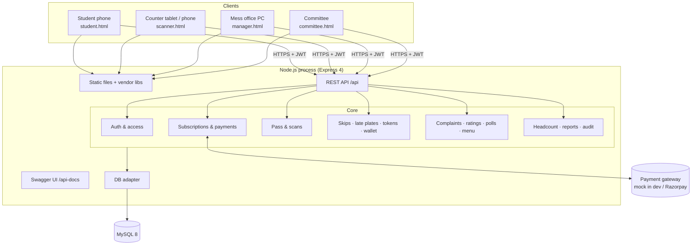
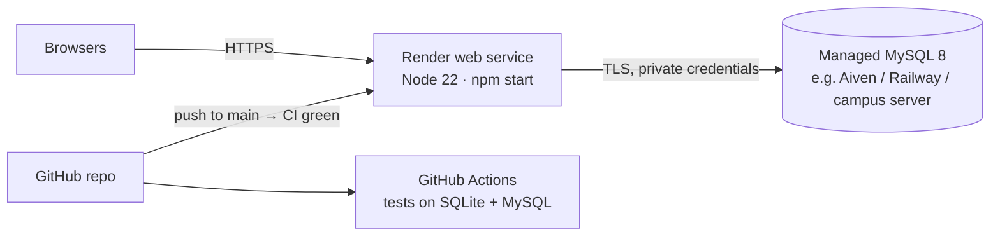

# 05 · Architecture

Owner: Arkodyuti (Software Architect). Decisions are recorded as ADRs in [`adr/`](adr/).

## 1. Architectural style
A **layered monolith** (one Node.js process, one database) exposing a REST API and serving static pages. For one mess with a few thousand students, one process handles the load easily (a scan is about 6 indexed queries). It is also the only style a four-person student team can build, test and defend in one semester ([ADR-0003](adr/0003-layered-monolith.md)).

## 2. Component view

## 3. Deployment view

Campus alternative: the same app on a university VM behind the campus reverse proxy with the university's MySQL. Nothing in the code depends on the host. See [11-deployment.md](11-deployment.md).

## 4. Technology choices

| Concern | Choice | Why (short) | ADR |
|---|---|---|---|
| Process model | Incremental + Scrum | Graded phases need documents; requirements will change | [0001](adr/0001-process-model.md) |
| Stack | HTML/CSS/JS, Node + Express 4, MySQL | Taught in the course, so the team can defend it; no build step | [0002](adr/0002-tech-stack.md) |
| Structure | Layered monolith | Smallest thing that works; clear layers | [0003](adr/0003-layered-monolith.md) |
| Payments | Gateway adapter; mock follows Razorpay's signature scheme | No merchant account; zero code change to go live | [0004](adr/0004-payment-verification.md) |
| Counter verification | Server-issued rotating HMAC pass | Defeats screenshots and sharing without hardware | [0005](adr/0005-rotating-qr-pass.md) |
| Auth | JWT bearer + bcrypt; roles re-read per request | Stateless and taught in the course; instant revocation via DB status | [0006](adr/0006-auth-jwt.md) |
| Database | One MySQL schema → SQLite generated for dev/tests | Zero-setup dev and fast tests, but production parity checked in CI | [0007](adr/0007-dual-database.md) |
| Multi-institution | One deployment + database per institution | Isolation by construction; no tenant id in every query | [0008](adr/0008-tenancy.md) |

## 5. Quality attributes and how the architecture meets them

| Attribute | Scenario | Mechanism |
|---|---|---|
| Integrity | Two counters scan the same pass at the same instant | DB UNIQUE key on `meal_logs`; the loser gets `already_served` |
| Integrity | Server crashes between "payment paid" and "subscription active" | Both updates run in one transaction |
| Security | Attacker replays a QR seen an hour ago | Step-window check (≤ 60 s) |
| Performance | 600 students in a 2-hour lunch (~5/min/counter) | Indexed lookups; scan path does not scan tables |
| Modifiability | Committee wants a new plan (CR-002) | Plans are data, not code: one seed row / one form |
| Testability | Meal windows depend on the time of day | Single clock (`utils/clock.js`) that tests freeze |
| Portability | Another university uses PostgreSQL | Only `db/index.js` changes (all SQL is ANSI-ish, `?` params) |
| Operability | Manager wants last month in Excel | CSV export endpoint |

## 6. Cross-cutting concerns
- **Time:** all meal logic in IST through `utils/time.js`; timestamps stored in UTC.
- **Money:** integers in paise; all formulas in `utils/pricing.js` (pure, unit-tested).
- **Errors:** `AppError(status, code, message)` → one error handler → consistent JSON.
- **Configuration:** `src/config/index.js` reads `.env`; runtime rules in the `settings` table.
- **Logging/audit:** `scan_attempts` and `audit_log` tables; server errors to stdout (captured by the host).
