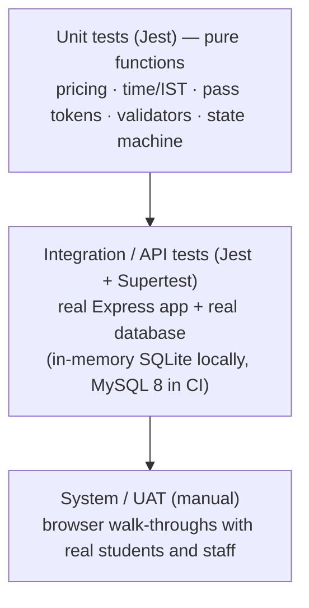

# 06 · Test plan

Owner: Sania (QA / Test Engineer). Standard: structure based on IEEE 829.

## 1. Objectives
Show that every **Must** requirement in the [SRS](02-srs.md) behaves as specified, that the anti-fraud guarantees hold under attack-style inputs, and that the system works on the production database (MySQL), not only on SQLite.

## 2. Scope
| In scope | Out of scope |
|---|---|
| All REST endpoints, business rules, money maths, pass tokens, permissions, DB constraints | Real payment gateway (mocked per ADR-0004); load testing at university scale (smoke-level timing only); third-party browser libraries |

## 3. Test levels and types

| Type | How | Where |
|---|---|---|
| Functional | Every FR has at least one positive and one negative API test | `tests/integration/*` |
| Boundary value | Meal windows at 07:29/07:30/09:29/09:30; cut-off ±1 min; pass age 30/65 s; stars 0/6; month ends; leap years | `time.test.js`, `passToken.test.js`, `meals.test.js` |
| Equivalence classes | Valid / invalid / missing inputs for register, dates, meals, IDs | `auth.test.js`, `rules.test.js` |
| State-transition | Subscription, token and complaint state machines, including illegal transitions | `subscriptions.test.js`, `rules.test.js`, `community.test.js` |
| Security | Forged pass, replayed screenshot, forged payment signature, other user's order, role escalation, disabled user with a valid token, CSV formula injection, malformed JSON, user enumeration | across integration suites |
| Concurrency / integrity | Double scan → UNIQUE constraint → 409; duplicate votes, skips, ratings | `scans.test.js`, `community.test.js` |
| Regression | Full suite on every push / PR in CI (SQLite + MySQL) | `.github/workflows/ci.yml` |
| Compatibility | MySQL 8 vs SQLite through one adapter | CI matrix |
| Usability / UAT | Scripted tasks with real users (below) | manual |

## 4. Approach
- **Deterministic time:** `utils/clock.js` is frozen in tests (`clock.setNow(ist('2026-11-20 13:00'))`), so meal windows, cut-offs and pass expiry are tested exactly.
- **Isolated data:** each test file gets a fresh database (`setupDb()`), and each test creates its own users (`makeUser()`), so tests do not depend on each other.
- **AAA pattern:** Arrange (create users/subscriptions) → Act (one API call) → Assert (status + body + DB side effects).
- **Fast:** bcrypt cost 4 in fixtures only; the whole suite runs in ~3 s.

## 5. Entry and exit criteria
| | Criteria |
|---|---|
| Entry | Story merged to a branch with its tests; CI configured |
| Exit (per sprint) | All tests pass on SQLite and MySQL; no open Critical bug; line coverage ≥ 80 % |
| Exit (release) | Above + UAT passed + test report updated |

## 6. UAT script (run with ≥ 3 students and 1 staff member)
| # | Task | Pass if |
|---|---|---|
| UAT-1 | Register as a new student | Account shows "pending" message |
| UAT-2 | (Manager) approve the student | Student can now subscribe |
| UAT-3 | Subscribe to a plan and pay | Done in < 3 min without help (NFR-06); subscription active |
| UAT-4 | Show the pass; staff scans it during a meal | SERVE within 3 s; second scan refused |
| UAT-5 | Screenshot the pass, wait 2 minutes, scan the screenshot | Refused as expired |
| UAT-6 | Skip tomorrow's lunch | Credit visible in wallet; manager headcount drops |
| UAT-7 | File a complaint; manager resolves it | Student sees the resolution |
| UAT-8 | Vote in a committee poll twice | Second vote refused |
| UAT-9 | Manager downloads the CSV and opens it in Excel | Opens with correct columns |

Record: tester, date, pass/fail, time taken, comments → `07-test-report.md §5`.

## 7. Defect management
GitHub issues with the *Bug report* template. Severity: **Critical** (wrong food/money decision, security), **Major** (feature unusable), **Minor** (cosmetic). Every fixed bug gets a regression test.

## 8. Roles
Sania owns the plan and the report; every developer writes tests for their own stories; reviewers check that tests exist before approving a PR.
