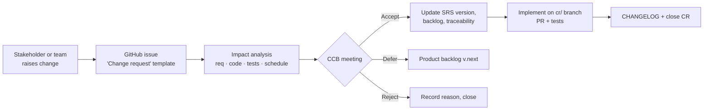

# 08 · Configuration and change management

Owner: Tarun (Configuration & Release Engineer), with Sania (Product & Project Lead) as CCB chair.

## 1. Configuration items (what is version-controlled)
| Item | Location | Versioned by |
|---|---|---|
| Source code | `src/`, `public/` | git commits, tags |
| Database schema | `database/schema.mysql.sql` | git (schema changes need a CR or a story) |
| Reference data | `src/db/seedData.js` | git |
| Requirements | `docs/02-srs.md` | revision table + tags `srs-v1.0`, `srs-v1.1` |
| Design & architecture | `docs/03…05`, `docs/adr/` | git; ADRs are never edited after acceptance, only superseded |
| Tests | `tests/` | git |
| API contract | `docs/openapi.yaml` | git |
| CI pipeline | `.github/workflows/ci.yml` | git |
| Runtime configuration | `.env` (never committed); `.env.example` documents every key | git (example only) |
| Business rules at runtime | `settings` table | `audit_log` rows |

## 2. Branching and merging
- `main` is always releasable and **protected**: no direct pushes, one approving review, CI must pass.
- Branch names: `feat/US-14-skip-meal`, `fix/<issue>-short`, `cr/CR-001-late-plates`, `docs/<topic>`.
- Commit messages: imperative, with the issue id (`Add skip credit calculation (US-14)`).
- Pull requests use the template in `.github/pull_request_template.md` (tests, traceability, CHANGELOG checklist).
- Merge with "squash and merge" for feature branches, so `main` has one commit per story.

## 3. Versioning and releases
Semantic Versioning: `MAJOR.MINOR.PATCH`.
- PATCH: bug fix, no behaviour change in the SRS.
- MINOR: new requirement or accepted CR (backwards compatible).
- MAJOR: breaking API or schema change.

Release = annotated tag (`git tag -a v1.0.0 -m "…"`) + GitHub Release with notes from `CHANGELOG.md`.

## 4. Change control process

**CCB:** Product & Project Lead (chair, decides on priority), Architect / QA (design and test impact), Developer (effort), Requirements Engineer (SRS update). Quorum: 3 of 4.

**Criteria:** value to stakeholders, effort vs remaining sprint capacity, risk, and whether it pushes out a Must requirement.

## 5. Change log
| CR | Title | Decision | Release |
|---|---|---|---|
| [CR-001](change-requests/CR-001-late-plates.md) | Late plates | Accepted | 1.0.0 |
| [CR-002](change-requests/CR-002-day-scholar-snacks-plan.md) | Day-scholar lunch + snacks plan | Accepted | 1.0.0 |
| [CR-003](change-requests/CR-003-guest-meals.md) | Guest meal passes | Deferred | 1.1 (planned) |

## 6. Runtime rule changes
Price and rule changes made by the mess office through the dashboard are not code changes. They are recorded automatically in `audit_log` (`setting_changed`, `plan_updated`, `meal_price_updated`) with who and when.
