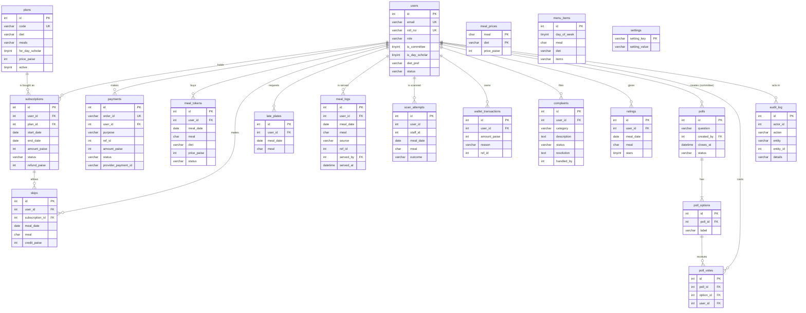

# Database design

Canonical schema: [`database/schema.mysql.sql`](../database/schema.mysql.sql) (MySQL 8). SQLite (dev/tests) is generated from it at start-up by `mysqlToSqlite()` in `src/db/index.js`. Reference data: `src/db/seedData.js`.

## Conventions
- Money in **paise** (`INT`), never floating point.
- `DATE` columns hold IST calendar dates (`YYYY-MM-DD`); `DATETIME` columns hold **UTC** timestamps.
- Meal codes `B`, `L`, `S`, `D`. Diet `veg` / `nonveg`.
- Status columns are `VARCHAR` + `CHECK` (portable across MySQL and SQLite) instead of `ENUM`.
- Wallet balance is **derived** (`SUM(amount_paise)`), never stored, so it cannot drift.
- Business invariants are enforced by **UNIQUE keys**, not only by code: one plate (`meal_logs`), one skip, one late plate, one token and one rating per student per meal; one vote per student per poll.

## ER diagram

## Data dictionary

| Table | Purpose | Key constraints |
|---|---|---|
| `users` | Every person: students (incl. day scholars and committee), staff, managers, admins | `email` UNIQUE, `roll_no` UNIQUE, CHECK on role/status/diet |
| `plans` | Monthly offers. `meals` is a comma list such as `B,L,S,D` | `code` UNIQUE, `price_paise > 0` |
| `meal_prices` | Price of one pay-per-meal token by meal and diet | PK (`meal`, `diet`) |
| `payments` | Gateway orders. `purpose` + `ref_id` point at the subscription or token being paid for | `order_id` UNIQUE |
| `subscriptions` | A plan bought for `start_date..end_date` (one calendar month). Status: `pending_payment → active → cancel_requested → cancelled` | FK user, plan; index (user, dates) |
| `meal_tokens` | One paid meal. Status `pending_payment → active → used` | UNIQUE (user, date, meal) |
| `skips` | Advance opt-out with the credit granted | UNIQUE (user, date, meal) |
| `late_plates` | "Keep my plate" requests | UNIQUE (user, date, meal) |
| `meal_logs` | One row per plate actually served | **UNIQUE (user, date, meal)** — the one-plate guarantee |
| `scan_attempts` | Every scan and its outcome (`served`, `invalid_token`, `expired_token`, `account_inactive`, `meal_skipped`, `no_entitlement`, `outside_meal_hours`, `already_served`) | index (user, date) |
| `wallet_transactions` | Credits (+) and debits (−); reasons `skip_credit`, `skip_reversal`, `cancel_refund`, `token_purchase` | FK user |
| `complaints` | Tickets: `open`, `in_progress`, `escalated`, `resolved` | FK user |
| `ratings` | 1–5 stars for a served meal | UNIQUE (user, date, meal), CHECK 1–5 |
| `menu_items` | Weekly menu slot | UNIQUE (day, meal, diet) |
| `polls`, `poll_options`, `poll_votes` | Committee polls | UNIQUE (poll, user) on votes |
| `settings` | Editable rules, defaults in `src/config` | PK key |
| `audit_log` | Administrative actions | — |

## Normalisation
All tables are in **3NF**: every non-key attribute depends on the whole key and only the key. Two deliberate exceptions, both documented:
- `plans.meals` stores a short comma list instead of a `plan_meals` join table. The list is fixed per plan, read-only after creation, and never queried by individual meal in SQL. A join table would add a join to every entitlement check (the hottest query) for no benefit. Revisit if plans become user-defined.
- `subscriptions.amount_paise` copies a computed price. This is a **historical fact** (what was charged), not redundant data: the plan price may change later.

## Reference and demo data (`npm run seed`)
- 5 plans: Hostel veg ₹3,600, Hostel non-veg ₹4,200, Day-scholar veg lunch ₹1,500, Day-scholar non-veg lunch ₹1,800, Day-scholar veg lunch + snacks ₹2,000 (added by CR-002). **Placeholder prices; replace with the mess office's real ones.**
- 8 token prices (each meal × diet).
- A 7-day menu for veg and non-veg (56 slots).
- Demo users listed in the README (password `MealSync@123`). Do not seed demo users in production.
